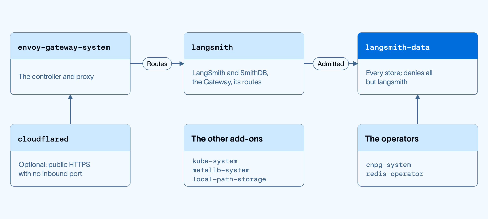
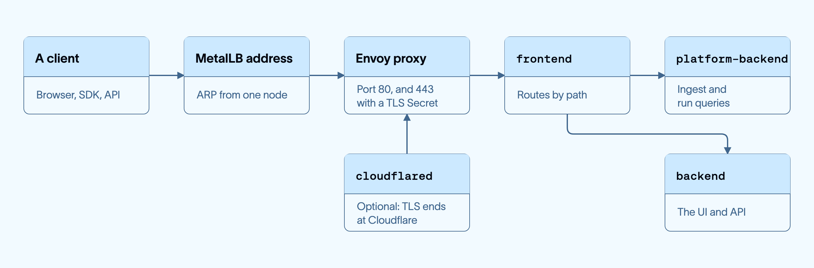
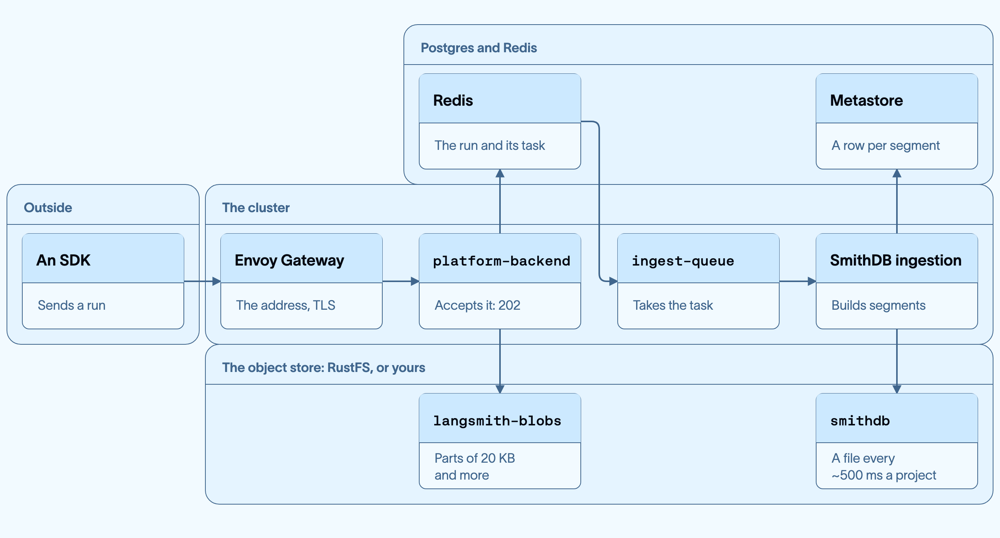
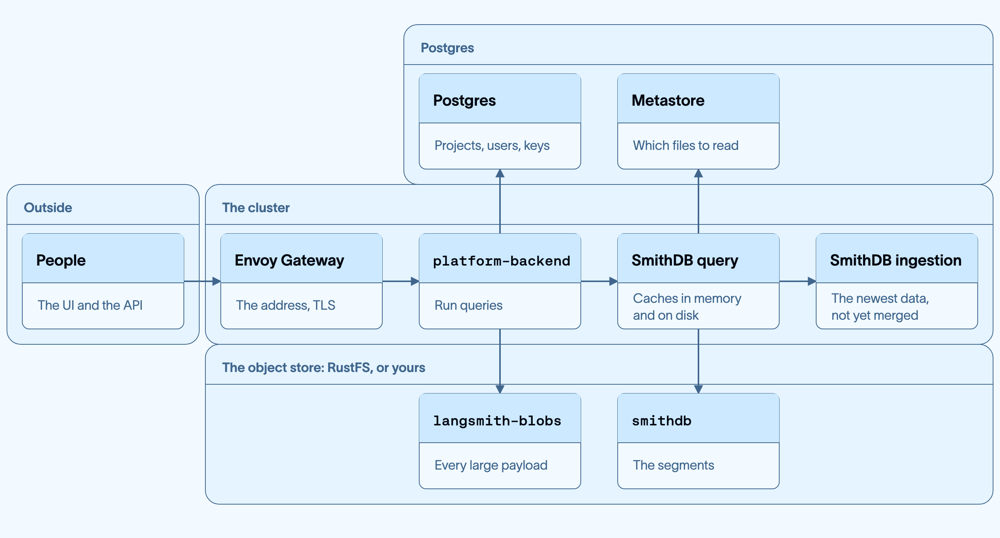

# Architecture: LangSmith + SmithDB on bare-metal Kubernetes

This module replaces the managed services a cloud provides with small, in-cluster equivalents, then installs LangSmith
with SmithDB as the trace store (by default the only one; ClickHouse beside it for a migration, [SMITHDB.md](SMITHDB.md)). This page covers what runs where, how requests and traces flow, and why each piece
was chosen. For the overview diagram and quick start, see [README.md](README.md).

## Two passes

| Pass | Tool | Creates |
|---|---|---|
| 1. Infrastructure | Terraform (`infra/`) | cluster add-ons, ingress, the datastores (one Helm release of [charts/datastores](charts/datastores/README.md)), their Secrets, the `langsmith` namespace |
| 2. Application | Helm (`helm/scripts/deploy.sh`) | LangSmith and SmithDB, from the chart pinned in `deploy.sh` |

Terraform never installs the LangSmith chart. It emits two outputs, `langsmith_helm_values` and `smithdb_helm_values`,
that `init-values.sh` writes as YAML, so the Helm release can be upgraded on its own cadence.

## Namespaces

<picture>
  <source media="(prefers-color-scheme: dark)" srcset="diagrams/namespaces-dark.png">
  
</picture>

- Every datastore runs in **one data namespace** beside LangSmith's (`datastore_namespace`, default `langsmith-data`),
  each named for its instance, with a generated password, and the namespace's **default-deny NetworkPolicy** plus one
  policy per instance that admits only the `langsmith` namespace (your CNI must enforce NetworkPolicy, e.g. Calico or
  Cilium). A shared cluster gets one data namespace per environment, never one per store.
- The datastores are one release of the local chart `charts/datastores`, which can also be applied with your own Helm
  or Argo CD. `datastore_runtime` picks how Postgres and Redis run (the table below); with `operator`, the operators run
  in `cnpg-system` and `redis-operator`, and each store's policy also admits its operator.
- Datastore pods carry a shared label with **preferred pod anti-affinity**, so the scheduler spreads them across nodes
  instead of stacking them on one disk.

## Components

| Component | What it does here | Why this choice |
|---|---|---|
| metrics-server | pod CPU/memory for HPAs and `kubectl top` | the chart's HPAs need it; bare clusters don't ship it |
| local-path provisioner | two StorageClasses: `local-path` (Delete) and `local-path-retain` (Retain), directories on node disk | simplest dynamic provisioning without a storage system; Retain for datastores so data survives a deleted claim |
| MetalLB (L2) | answers ARP for `LoadBalancer` IPs. The gateway IP sits alone in pool `langsmith-gateway` with auto-assign off, so no other Service can take it; `lan-pool` (`metallb_addresses`) serves other Services. Speakers run on every node except those labeled `node.kubernetes.io/exclude-from-external-load-balancers` (kubeadm's control plane) | the bare-metal equivalent of a cloud load balancer |
| Envoy Gateway | Gateway API implementation; the chart attaches its `HTTPRoute` to the `langsmith-gateway` Gateway | Gateway API is the chart's supported ingress path; one proxy, one IP |
| Route timeout policy | `BackendTrafficPolicy` on the chart's `HTTPRoute` and the LAN route; none on the stream routes | `envoy_gateway_route_timeout` ([README, Configuration](README.md#configuration)) |
| LAN catch-all route | extra `HTTPRoute` with no hostname, on when `langsmith_domain` is set | keeps `http://<gateway IP>` working when the chart's route matches only the domain |
| KEDA (only with `enable_deployments`) | scales each agent deployment through a ScaledObject the LangSmith operator creates | the chart's operator expects it (`operator.kedaEnabled`) |
| cloudflared (optional) | 2-replica Cloudflare Tunnel connector pointing at the Envoy Service | public HTTPS with no inbound ports or public IP |
| Postgres 18 `langsmith` | orgs, projects, datasets, feedback config, run metadata | separate from the metastore so neither starves the other |
| Postgres 18 `smithdb` | SmithDB metastore: the index of every file in object storage | write-heavy during ingest; back it up with the object store |
| Redis 7 | ingest buffer (each run's data for `redisRunsExpirySeconds`), task queues | persisted (RDB), `noeviction`, expiry tuned for LangSmith's key churn |
| RustFS | S3-compatible object store: bucket `smithdb` (SmithDB files) and `langsmith-blobs` (large payloads) | maintained, Apache-2.0, single binary; MinIO community images are no longer published |
| CloudNativePG, OpsTree Redis operator (only with `datastore_runtime = "operator"`) | run Postgres as a `Cluster` and Redis as a `RedisReplication` in place of the StatefulSets | operators that keep running for failover and replicas; each its own release, since a custom resource cannot share a release with its CRD |
| ClickHouse (only with `clickhouse_source = "in-cluster"`) | the chart's StatefulSet in `langsmith`, beside SmithDB for dual ingest and the backfill | the source a migration to SmithDB reads; not part of the default install |
| TaskDB (only with `smithdb_migration_enabled`) | the chart's Postgres for the backfill Job's progress, in `langsmith` | lives only as long as the backfill |
| Redis 7 `redis-juicefs` (only with `enable_sandboxes`) | JuiceFS metadata for sandbox volumes; AOF, `noeviction`; data in bucket `sandbox-juicefs` on the same RustFS | kept apart from LangSmith's Redis, whose expiry would lose filesystem metadata |

## Datastores in each runtime

| Store | `statefulset` (default) | `operator` | What LangSmith reads, in both |
|---|---|---|---|
| Postgres `postgres-langsmith`, `postgres-smithdb` | StatefulSet and headless Service named for the instance on `postgres:18.6`, product databases made by a Job | CloudNativePG `Cluster` named for the instance on its own 18.6 image, a managed Service of that name on the primary, product databases as `Database` resources | `postgres-<instance>.langsmith-data.svc.cluster.local:5432`, a superuser owner ([its extensions](https://docs.langchain.com/langsmith/self-host-external-postgres#requirements)), the same password |
| Redis `redis-langsmith`, `redis-juicefs` | StatefulSet and headless Service named for the instance on `redis:7.4.11`, config and password in a mounted `redis.conf` | OpsTree `RedisReplication` `redis-<instance>-replication` on its 7.4.11 image, the same settings as an included config file; three Sentinels above one replica | `redis-<instance>.langsmith-data.svc.cluster.local:6379` (in the operator runtime a Service on the primary), `noeviction`, `maxmemory` three quarters of the limit |
| RustFS `rustfs` | StatefulSet `rustfs`, a Job per bucket | the same: no operator | `http://rustfs.langsmith-data.svc.cluster.local:9000`, the same keys |

With `datastore_replicas` above 1 (operator only) each Postgres is a primary and replicas CloudNativePG fails over,
and each Redis a primary, replicas and three Sentinels; the Services above follow the primary, so LangSmith's
connection strings never change. The budget counts every replica with its volume, the Sentinels and both controllers.

The module keeps generating every password and key and passes them as a second values document; the Secrets in
`langsmith` are built from the same passwords whichever runtime runs the stores.

Every store that runs as one pod (each store in the `statefulset` runtime, and RustFS in both) has a
PodDisruptionBudget of zero. Its volume is on one node, so it cannot move: `kubectl drain` of that node stops and names
the pod rather than taking the store down unannounced. To drain it, plan the outage, open the budget, drain, and close
it once the node is back:

```bash
kubectl -n langsmith-data patch pdb <store> --type merge -p '{"spec":{"maxUnavailable":1}}'
kubectl drain <node> --ignore-daemonsets --delete-emptydir-data
kubectl uncordon <node>
kubectl -n langsmith-data patch pdb <store> --type merge -p '{"spec":{"maxUnavailable":0}}'
```

An automated upgrade that drains nodes (k3s's or RKE2's system-upgrade-controller) waits on the same budget.

## Request path

<picture>
  <source media="(prefers-color-scheme: dark)" srcset="diagrams/request-path-dark.png">
  
</picture>

With the optional tunnel, Cloudflare terminates TLS and `cloudflared` forwards to the Envoy Service inside the cluster;
the MetalLB IP still serves the LAN.

## Write path: life of a trace

<picture>
  <source media="(prefers-color-scheme: dark)" srcset="diagrams/write-path-dark.png">
  
</picture>

platform-backend answers `202 Accepted` once the run is in Redis. On the ingestion pod the 500 ms files (L0) merge
into L1, and compaction merges L1 in the background.

Two consequences to plan for:

- **Redis holds every run for `redisRunsExpirySeconds` after ingest** (default 6 h), so Redis memory scales with
  runs/s × retained size × that window. Blob storage keeps the large parts out. See [SIZING.md](SIZING.md#redis).
- **A run still queued when its Redis entry expires is dropped without an error.** The ingest backlog must stay well under
  the expiry. Alert on the age of the oldest ingest task.

## Read path

<picture>
  <source media="(prefers-color-scheme: dark)" srcset="diagrams/read-path-dark.png">
  
</picture>

The UI and API call `platform-backend`, which queries `smithdb-query`. Older data is read from object storage through
the query pod's memory and disk caches. **A project's newest data, not yet merged, lives on the ingestion pods** and is
scanned there on every read, so reads of a project that is being written are slower than reads of idle projects. The
details and the settings that limit it are in [SMITHDB.md](SMITHDB.md#reads-of-a-project-being-written).

## Storage

| Data | Where | StorageClass | Lifecycle |
|---|---|---|---|
| Postgres ×2, Redis RDB, RustFS objects (and the JuiceFS Redis with Sandboxes) | one PVC each, on one node's disk | `local-path-retain` | kept when the claim is deleted; clean up by hand |
| ClickHouse (migration only) | the chart's StatefulSet volume | `local-path-retain` | kept after `helm uninstall`; clean up by hand ([TEARDOWN.md](TEARDOWN.md)) |
| TaskDB (backfill only) | the chart's StatefulSet volume | `local-path` (or your `storage_class`) | deleted with its claim: it holds only the backfill's progress |
| SmithDB caches (query, ingestion, compaction scratch) | `emptyDir` with a size limit (minimal tier) or per-pod PVCs (larger tiers) | node disk / `local-path` | disposable; rebuilt from object storage |
| platform-backend scratch | node ephemeral storage | — | disposable |

Important properties of local-path volumes:

- **Sizes are not enforced.** A PVC's size is a label for scheduling and the budget; the directory can fill the node's
  root filesystem. Watch node disk usage.
- **Volumes are pinned to a node.** If that node is lost, so is the volume. Back up Postgres (both) and the object store.
- **No replication.** For durability, use a storage system with replication or external managed services.
- **The filesystem is the node's.** Databases and the object store fsync and rename constantly; on a
  copy-on-write filesystem (btrfs as most desktop installs set it up, with compression) those wait on the
  filesystem's commits. Use ext4 or XFS for `local_path_node_path`, or a btrfs subvolume with copy-on-write
  off, outside any snapshot schedule.

## The budget gate

Before any resource is created, `budget.tf` sums the requests of every pod the configuration will run (add-ons,
datastores, LangSmith at the chosen profile, SmithDB tier, enabled features, and a reserve per expected agent
deployment) and compares them with `cluster_nodes`, minus `node_reserved` per worker, times `max_request_ratio`
(default 0.7). A profile that doesn't fit fails the plan with the numbers. `terraform output budget` shows the breakdown.

The gate reads no cluster: it counts only what this module runs, against the nodes as you typed them. On a cluster that
already runs other workloads, give `cluster_nodes` what is free (allocatable less those workloads' requests, from
`kubectl describe nodes`), or a green plan can still leave pods Pending.

So that the gate counts what runs, Terraform also writes the requests it budgeted into the Helm values: the
SmithDB components, and every optional feature component (host-backend, listener, operator, the Fleet servers, and the
Polly and Insights API and queue). Their limits come from the full-tier sizes whatever the profile, because limits don't
count in the budget and work-heavy services need the headroom. The sizing and feature example files deliberately set no
resources for these components. Settings in your own `langsmith-values-local.yaml` still override everything.

Nodes with role `smithdb-cache` or `smithdb-compute` get labels and taints so SmithDB's cache-heavy or CPU-heavy
components can be pinned to them.

## Security notes

- App secrets (license, admin password, salts, encryption keys) live in `infra/.secrets.env` (mode 600, gitignored) and
  reach the cluster only through `deploy.sh`, on stdin. Datastore credentials are generated by Terraform and stored in
  Kubernetes Secrets, so they are also in Terraform state: keep the state private.
- Generated Helm values for LangSmith contain no secrets; the chart reads every credential from existing Secrets. The
  datastores chart takes the generated passwords as values, so they are also in its Helm release Secret in
  `langsmith`.
- The in-cluster stores speak plain TCP: Postgres without TLS, Redis without TLS, RustFS over HTTP. Their traffic stays
  inside the cluster network, each store admits only the `langsmith` namespace (NetworkPolicy, which your CNI must
  enforce), and each authenticates with a generated password. A security review that requires encryption in transit
  inside the cluster needs a CNI that encrypts pod traffic (Cilium or Calico with WireGuard, for instance) or external
  stores with TLS (`<store>_source = "external"`).
- The gateway listener is plain HTTP by default. Before exposing LangSmith beyond a trusted network, add an HTTPS
  listener (`gateway_tls_secret`) or terminate TLS in front of it (the Cloudflare Tunnel option does this).
