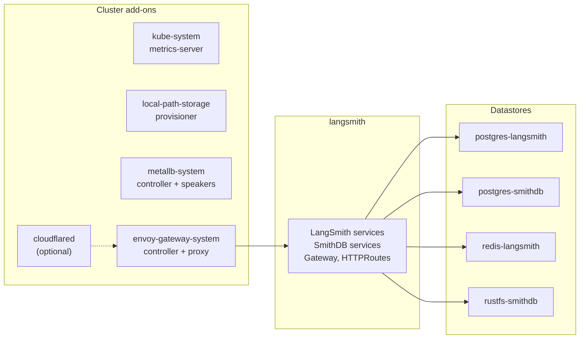
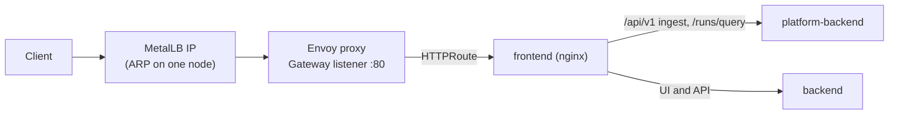
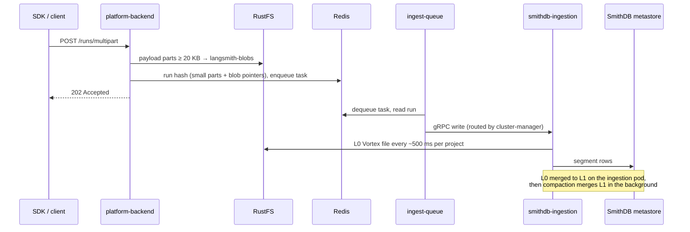

# Architecture: LangSmith + SmithDB on bare-metal Kubernetes

This module replaces the managed services a cloud provides with small, in-cluster equivalents, then installs LangSmith
with SmithDB as the only trace store. This page covers what runs where, how requests and traces flow, and why each piece
was chosen. For the overview diagram and quick start, see [README.md](README.md).

## Two passes

| Pass | Tool | Creates |
|---|---|---|
| 1. Infrastructure | Terraform (`infra/`) | cluster add-ons, ingress, datastores, their Secrets, the `langsmith` namespace |
| 2. Application | Helm (`helm/scripts/deploy.sh`) | LangSmith and SmithDB, from the chart pinned in `deploy.sh` |

Terraform never installs the LangSmith chart. It emits two outputs, `langsmith_helm_values` and `smithdb_helm_values`,
that `init-values.sh` writes as YAML, so the Helm release can be upgraded on its own cadence.

## Namespaces

- Each datastore gets **its own namespace**, a generated password, and a **default-deny NetworkPolicy** that admits only
  the `langsmith` namespace (Postgres and Redis; your CNI must enforce NetworkPolicy, e.g. Calico or Cilium).
- Datastore pods carry a shared label with **preferred pod anti-affinity**, so the scheduler spreads them across nodes
  instead of stacking them on one disk.

## Components

| Component | What it does here | Why this choice |
|---|---|---|
| metrics-server | pod CPU/memory for HPAs and `kubectl top` | the chart's HPAs need it; bare clusters don't ship it |
| local-path provisioner | two StorageClasses: `local-path` (Delete) and `local-path-retain` (Retain), directories on node disk | simplest dynamic provisioning without a storage system; Retain for datastores so data survives a deleted claim |
| MetalLB (L2) | answers ARP for `LoadBalancer` IPs. The gateway IP sits alone in pool `langsmith-gateway` with auto-assign off, so no other Service can take it; `lan-pool` (`metallb_addresses`) serves other Services. Speakers run on every node except those labeled `node.kubernetes.io/exclude-from-external-load-balancers` (kubeadm's control plane) | the bare-metal equivalent of a cloud load balancer |
| Envoy Gateway | Gateway API implementation; the chart attaches its `HTTPRoute` to the `langsmith-gateway` Gateway | Gateway API is the chart's supported ingress path; one proxy, one IP |
| Route timeout policy | `BackendTrafficPolicy` on the Gateway, default 60 s | Envoy's 15 s default returns 504 on slow trace reads |
| LAN catch-all route | extra `HTTPRoute` with no hostname, on when `langsmith_domain` is set | keeps `http://<gateway IP>` working when the chart's route matches only the domain |
| KEDA (only with `enable_deployments`) | scales each agent deployment through a ScaledObject the LangSmith operator creates | the chart's operator expects it (`operator.kedaEnabled`) |
| cloudflared (optional) | 2-replica Cloudflare Tunnel connector pointing at the Envoy Service | public HTTPS with no inbound ports or public IP |
| Postgres 18 `langsmith` | orgs, projects, datasets, feedback config, run metadata | separate from the metastore so neither starves the other |
| Postgres 18 `smithdb` | SmithDB metastore: the index of every file in object storage | write-heavy during ingest; back it up with the object store |
| Redis 7 | ingest buffer (each run's data for `redisRunsExpirySeconds`), task queues | persisted (RDB), `noeviction`, expiry tuned for LangSmith's key churn |
| RustFS | S3-compatible object store: bucket `smithdb` (SmithDB files) and `langsmith-blobs` (large payloads) | maintained, Apache-2.0, single binary; MinIO community images are no longer published |

## Request path

With the optional tunnel, Cloudflare terminates TLS and `cloudflared` forwards to the Envoy Service inside the cluster;
the MetalLB IP still serves the LAN.

## Write path: life of a trace

Two consequences to plan for:

- **Redis holds every run for `redisRunsExpirySeconds` after ingest** (default 6 h), so Redis memory scales with
  runs/s × retained size × that window. Blob storage keeps the large parts out. See [SIZING.md](SIZING.md#redis).
- **A run still queued when its Redis entry expires is dropped without an error.** The ingest backlog must stay well under
  the expiry. Alert on the age of the oldest ingest task.

## Read path

The UI and API call `platform-backend`, which queries `smithdb-query`. Older data is read from object storage through
the query pod's memory and disk caches. **A project's newest data, not yet merged, lives on the ingestion pods** and is
scanned there on every read, so reads of a project that is being written are slower than reads of idle projects. The
details and the settings that limit it are in [SMITHDB.md](SMITHDB.md#reads-of-a-project-being-written).

## Storage

| Data | Where | StorageClass | Lifecycle |
|---|---|---|---|
| Postgres ×2, Redis RDB, RustFS objects | one PVC each, on one node's disk | `local-path-retain` | kept when the claim is deleted; clean up by hand |
| SmithDB caches (query, ingestion, compaction scratch) | `emptyDir` with a size limit (minimal tier) or per-pod PVCs (larger tiers) | node disk / `local-path` | disposable; rebuilt from object storage |
| platform-backend scratch | node ephemeral storage | — | disposable |

Important properties of local-path volumes:

- **Sizes are not enforced.** A PVC's size is a label for scheduling and the budget; the directory can fill the node's
  root filesystem. Watch node disk usage.
- **Volumes are pinned to a node.** If that node is lost, so is the volume. Back up Postgres (both) and the object store.
- **No replication.** For durability, use a storage system with replication or external managed services.

## The budget gate

Before any resource is created, `budget.tf` sums the requests of every pod the configuration will run (add-ons,
datastores, LangSmith at the chosen profile, SmithDB tier, enabled features, and a reserve per expected agent
deployment) and compares them with `cluster_nodes`, minus `node_reserved` per worker, times `max_request_ratio`
(default 0.7). A profile that doesn't fit fails the plan with the numbers. `terraform output budget` shows the breakdown.

So that the gate counts what actually runs, Terraform also writes the requests it budgeted into the Helm values: the
SmithDB components, and every optional feature component (host-backend, listener, operator, the Fleet servers, and the
Polly and Insights API and queue). Their limits come from the full-tier sizes whatever the profile, because limits don't
count in the budget and work-heavy services need the headroom. The sizing and feature example files deliberately set no
resources for these components. Settings in your own `langsmith-values-local.yaml` still override everything.

Nodes with role `smithdb-cache` or `smithdb-compute` get labels and taints so SmithDB's cache-heavy or CPU-heavy
components can be pinned to them; `sandbox-host` nodes are excluded from the LangSmith budget.

## Security notes

- App secrets (license, admin password, salts, encryption keys) live in `infra/.secrets.env` (mode 600, gitignored) and
  reach the cluster only through `deploy.sh`, on stdin. Datastore credentials are generated by Terraform and stored in
  Kubernetes Secrets, so they are also in Terraform state: keep the state private.
- Generated Helm values contain no secrets; the chart reads every credential from existing Secrets.
- The gateway listener is plain HTTP. Terminate TLS in front of it (the Cloudflare Tunnel option does this) before
  exposing LangSmith beyond a trusted network.
