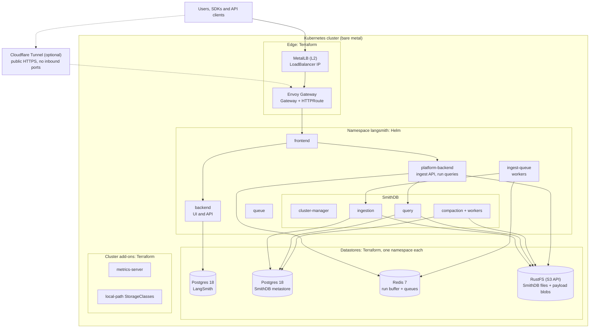

# Reference example: LangSmith with SmithDB on self-managed Kubernetes

**Status: Example.** Tested on kubeadm. Not a supported deployment path.

## What this example is, and what it is not

- It **is** one tested way to run self-hosted LangSmith with SmithDB (no ClickHouse) on an existing Kubernetes cluster,
  with no cloud provider. Terraform deploys what a cloud would otherwise provide, then Helm installs LangSmith.
- It is **not** an installer that LangChain supports, and it is **not** a production blueprint. The sizes, IP addresses
  and settings in it are examples to adapt.
- **Support boundary:** LangChain supports the LangSmith application under your agreement. You own every layer this
  example adds: load balancing, ingress, storage, Postgres, Redis, object storage, backups and upgrades.

## What LangSmith needs, and how this example meets it

| Need | This example | For production |
|---|---|---|
| LoadBalancer IPs | MetalLB (L2): one dedicated IP for the gateway, a pool for other Services | your existing load balancer (BGP, F5, kube-vip) |
| Ingress | Envoy Gateway (Gateway API), 60 s route timeout | your ingress controller or Gateway, through the chart's `ingress` or `gateway` values |
| Volumes | local-path: node-local, no replication | a replicated StorageClass (Ceph, Longhorn, SAN CSI) |
| Postgres (LangSmith and SmithDB metastore) | one pod each | managed or HA Postgres with point-in-time recovery, through `postgres.external` and `smithdb.config.metastore` |
| Redis | one pod | managed or HA Redis or Valkey, through `redis.external` |
| S3-compatible storage | one RustFS pod (SmithDB data and payload blobs) | a replicated object store (Ceph RGW, an enterprise S3, AWS S3) |
| Pod metrics for autoscaling | metrics-server | your cluster's metrics-server |
| Autoscaling for agent deployments (only with LangSmith Deployments) | KEDA | your cluster's KEDA |
| TLS | none at the gateway; optional Cloudflare Tunnel | TLS at your load balancer or Gateway |
| Backups | not covered | metastore and bucket backups taken at the same point in time |

What carries over to any Kubernetes deployment, whatever you swap: the Helm values layering, the SmithDB settings
([SMITHDB.md](SMITHDB.md)), the sizing method ([SIZING.md](SIZING.md)) and the checks in
[TROUBLESHOOTING.md](TROUBLESHOOTING.md).

## Tested

| Distribution | Kubernetes | Runtime | CNI | Nodes | Chart | Tested |
|---|---|---|---|---|---|---|
| kubeadm on Ubuntu 22.04 | v1.36.5 | containerd 2.4.1 | Calico v3.33.0 | 4 (1 control plane, 3 workers) | langsmith 0.17.11 (app and SmithDB 0.17.38); earlier load tests on 0.17.6 | install, upgrade, deploy, load test, blob offload, an agent deployment |

Add-ons as tested: MetalLB 0.16.1, Envoy Gateway v1.9.2, metrics-server chart 3.14.0, KEDA 2.21.0.

**Other distributions need changes.** k3s ships servicelb, local-storage and metrics-server by default
([packaged components](https://docs.k3s.io/installation/packaged-components)), which collide with the MetalLB, local-path
and metrics-server this example installs: start k3s with `--disable servicelb --disable local-storage --disable
metrics-server`. RKE2 ships its own metrics-server, so the same collision applies there: disable it, or remove
`module.metrics_server` from this example.

## Architecture



How a trace moves through it, every component, and why each piece is there: [ARCHITECTURE.md](ARCHITECTURE.md).
SmithDB specifics and tuning: [SMITHDB.md](SMITHDB.md). Sizing formulas: [SIZING.md](SIZING.md).

## What you get

| Layer | Component | Managed by |
|---|---|---|
| Cluster add-ons | metrics-server (for HPAs), local-path StorageClasses (`local-path`, `local-path-retain`) | Terraform |
| Load balancing | MetalLB in L2 mode: the gateway IP in its own pool (never auto-assigned), a pool for other Services | Terraform |
| Ingress | Envoy Gateway (Gateway API): one Gateway, route timeout policy, optional LAN catch-all route | Terraform |
| Public access (optional) | Cloudflare Tunnel connector (`cloudflared`, 2 replicas) | Terraform |
| Datastores | Postgres 18 ×2 (LangSmith, SmithDB metastore), Redis 7, RustFS (S3 API) with buckets | Terraform |
| Secrets | Datastore credentials as Kubernetes Secrets; app secrets in a local `infra/.secrets.env` (mode 600) | Terraform + scripts |
| Application | LangSmith chart 0.17.x (line-pinned) with SmithDB (ClickHouse disabled) | Helm (`deploy.sh`) |
| Agent deployments (optional) | KEDA, plus the chart's host-backend, listener and operator | Terraform + Helm |
| Guardrails | Budget gate: requested CPU/memory checked against your nodes before anything is applied | Terraform |

## Assumptions

This module is opinionated. It assumes:

- **A working Kubernetes cluster** you can reach with `kubectl`, with at least three schedulable worker nodes. It doesn't
  create the cluster. Tested on kubeadm; other distributions need the changes under [Tested](#tested).
- **One Layer 2 network** for the nodes, with unused IP addresses outside your DHCP pool: one for the gateway, and a
  range for MetalLB that doesn't include it.
- **Node-local storage.** local-path volumes are directories on one node's disk: fast (NVMe recommended), but each volume
  is pinned to its node and has **no replication**. Back up Postgres and the object store yourself.
- **Single-instance datastores.** Postgres, Redis and RustFS each run as one pod. That fits evaluation, development and
  small production. For high availability, run managed or HA services and point the chart at them instead.
- **Containers can open enough files:** containerd `LimitNOFILE=1048576` on every node (the default soft limit of 1,024
  silently breaks the SmithDB disk cache).
- **No ClickHouse.** SmithDB is the only trace store.

Not covered: building the cluster or its OS, TLS on the gateway itself (terminate TLS in front of it, e.g. with the
Cloudflare Tunnel), backups, multi-cluster or HA setups.

## Prerequisites

| Tool | Version |
|---|---|
| Terraform | ≥ 1.11 |
| kubectl | matching your cluster |
| Helm | ≥ 3.12 (Helm 4 works) |
| python3 | any 3.x (scripts use the standard library only) |

A LangSmith Enterprise license key, and cluster-admin access to the target cluster (the module installs cluster-wide
add-ons: MetalLB, Envoy Gateway, metrics-server, local-path).

## Quick start

From `modules/baremetal/`:

```bash
# 1. Describe your cluster
cp infra/terraform.tfvars.example infra/terraform.tfvars
$EDITOR infra/terraform.tfvars        # kube context, nodes, IP range, sizing profile

# 2. Cluster add-ons and datastores
make init
make plan                             # read the budget output: requests vs your nodes
make apply

# 3. App secrets (license key, admin login, generated keys) → infra/.secrets.env
make setup-env

# 4. Helm values from Terraform outputs → helm/values/
make init-values

# 5. Install LangSmith + SmithDB
make deploy
```

`make deploy` prints the URL when every component is ready. Log in with `INITIAL_ORG_ADMIN_EMAIL` and the password from
`infra/.secrets.env`.

The first `make apply` installs the MetalLB and Envoy Gateway CRDs. If your Terraform version can't plan resources that
depend on CRDs that don't exist yet, apply the add-ons first:
`make apply ARGS="-target=module.metallb -target=module.envoy_gateway"`, then `make apply`.

## Sizing profiles

`sizing_profile` selects both the app sizing and the SmithDB tier. Before anything is applied, the budget gate sums
every pod's requests and rejects a profile that doesn't fit your `cluster_nodes`.

| Profile | App sizing | SmithDB tier | Use for |
|---|---|---|---|
| `minimum` | smallest replicas and requests | minimal | trying it out |
| `lab` | dev | minimal | a small cluster (~18 vCPU, ~48 GiB of workers) with real load |
| `dev` | dev | small (chart tier) | shared dev or staging |
| `production` | production | medium (chart tier) | production |
| `production-large` | production-large | medium (chart tier) | high-volume production |

How to size for a specific workload (traces/s, payload size, users): [SIZING.md](SIZING.md).

## Configuration

All settings are in `infra/terraform.tfvars`; [terraform.tfvars.example](infra/terraform.tfvars.example) lists every one.

| Variable | Required | Purpose |
|---|---|---|
| `kubeconfig_path`, `kube_context` | yes | the cluster; the context is required so the module never acts on your current context |
| `cluster_nodes` | yes | node names, allocatable CPU/memory/disk and roles, for the budget gate and optional SmithDB node pools |
| `envoy_gateway_lb_ip`, `metallb_addresses` | yes | the gateway's IP (its own pool), and a separate range for other LoadBalancer Services |
| `sizing_profile` | no (`minimum`) | see above |
| `langsmith_domain`, `langsmith_url_scheme` | no | hostname and scheme (default `http://<gateway IP>`) |
| `envoy_gateway_route_timeout` | no (`60s`) | request timeout on every route; Envoy's own default of 15 s cuts off slow trace reads |
| `enable_deployments` (installs KEDA), `enable_fleet`, `enable_standalone_insights`, `enable_standalone_polly`, `enable_sandboxes`, `enable_sso_oidc`, `enable_usage_telemetry` | no | features, same flags as the cloud modules |
| `enable_cloudflare_tunnel` + `TF_VAR_cloudflare_tunnel_token` | no | public HTTPS through a Cloudflare Tunnel |
| `node_reserved`, `max_request_ratio` | no | budget gate headroom |
| `*_image`, `*_chart_version` | no | pinned versions |

### Helm values layering

`make deploy` passes these files to Helm in order (last wins):

| File | Source |
|---|---|
| `helm/values/values.yaml` | committed base: external Postgres/Redis, ClickHouse off, gateway on |
| `langsmith-values-overrides.yaml` | Terraform output: hostname, gateway |
| `langsmith-values-admin.yaml` | initial admin email |
| `langsmith-values-sizing-<profile>.yaml` | copied once from `helm/values/examples/` |
| `langsmith-values-<feature>.yaml` | one per enabled feature |
| `langsmith-values-smithdb.yaml` | Terraform output: SmithDB sizing, cache, object store and metastore wiring |
| `langsmith-values-local.yaml` | **optional**, yours: your tuning; start from [langsmith-values-local.yaml.example](helm/values/langsmith-values-local.yaml.example) |

Generated files are gitignored. Secrets never go into values files: `deploy.sh` builds the `langsmith-config` Secret from
`infra/.secrets.env` and passes it to `kubectl` on stdin.

## Tuning for your workload

The defaults fit a small cluster. Everything that sizes LangSmith for a real workload is a setting you own, in one of
two places, and a redeploy applies it:

| What to tune | Where | Guide |
|---|---|---|
| Overall size: replicas and requests of every service, SmithDB tier | `sizing_profile` in `infra/terraform.tfvars` | [Sizing profiles](#sizing-profiles) |
| Nodes, headroom kept free for the OS, share of capacity pods may request | `cluster_nodes`, `node_reserved`, `max_request_ratio` | [ARCHITECTURE.md](ARCHITECTURE.md#the-budget-gate) |
| Large payloads out of Redis, and the size threshold | `enable_blob_storage`, `blob_storage_min_size_kb` | [SIZING.md](SIZING.md#redis) |
| How long runs stay in Redis (Redis memory) | `config.settings.redisRunsExpirySeconds` in `langsmith-values-local.yaml` | [SIZING.md](SIZING.md#redis) |
| Ingest throughput (workers per pod, pods) | `ingestQueue` in `langsmith-values-local.yaml` | [SIZING.md](SIZING.md#ingest-workers-ingest-queue) |
| Read capacity | `smithdb.query` replicas in `langsmith-values-local.yaml` | [SIZING.md](SIZING.md#reads-smithdb-query) |
| SmithDB memory, cache and scratch volumes, replicas | `smithdb.<component>.deployment` in `langsmith-values-local.yaml` | [SMITHDB.md](SMITHDB.md), [SIZING.md](SIZING.md#smithdb-memory) |
| Any other chart value | `langsmith-values-local.yaml` (applied last, overrides everything generated) | the LangSmith Helm chart's `values.yaml` |
| Request timeout at the gateway | `envoy_gateway_route_timeout` | [TROUBLESHOOTING.md](TROUBLESHOOTING.md#networking-and-ingress) |

Start from the recommended settings in the example values file. Each one carries its reason and the assumption behind
its value:

```bash
cp helm/values/langsmith-values-local.yaml.example helm/values/langsmith-values-local.yaml
$EDITOR helm/values/langsmith-values-local.yaml     # size the values for your load with SIZING.md
make deploy                                          # Terraform settings: make plan && make apply first
```

To tune with confidence, measure: send traces shaped like your production ones (runs per trace, payload sizes) at your
expected rate, and watch Redis memory, the ingest queue backlog, and pod CPU and memory (`kubectl top`). The formulas in
[SIZING.md](SIZING.md) tell you which setting moves which number.

## LangSmith Deployments (optional)

With `enable_deployments = true` (and the Deployments entitlement in your license), `make apply` installs KEDA and
`make deploy` turns on host-backend, listener and operator. Agent deployments then run in the `langsmith` namespace:

- **Image:** build your agent with `langgraph build` (we recommend the Wolfi base: `"image_distro": "wolfi"` in
  `langgraph.json`) and push it to a registry your nodes can pull from. Create the deployment from that image in the UI
  or with the `/api-host/v2/deployments` API (`source: "external_docker"`).
- **Routing:** the operator adds an HTTPRoute per deployment on the module's Gateway, at
  `<LangSmith URL>/lgp/<deployment>`, and KEDA ScaledObjects for the agent and its queue worker.
- **Resources:** with the operator's defaults, each deployment requests about **3.2 CPU and 8.25 GiB**: the agent
  (200m/512Mi), a queue worker (1 CPU/2 GiB), Redis (1 CPU/2 GiB) and a Postgres StatefulSet (1 CPU/3.75 GiB, named
  `lg-<id>`) with a 20 GiB volume on the default StorageClass. `expected_agent_deployments` reserves that much each in
  the budget gate.

## Verify

```bash
kubectl --context <ctx> -n langsmith get pods           # all Running / Completed
kubectl --context <ctx> top pods -n langsmith            # metrics-server works
curl -s -o /dev/null -w '%{http_code}\n' http://<gateway IP>/api/v1/info   # 200
```

Then send a test trace with the LangSmith SDK (`LANGSMITH_ENDPOINT=http://<gateway IP>/api/v1`) and open it in the UI.

## Repository layout

```
modules/baremetal/
├── Makefile                       # make help
├── README.md, ARCHITECTURE.md, SMITHDB.md, SIZING.md, TROUBLESHOOTING.md, TEARDOWN.md
├── infra/                         # Terraform root
│   ├── main.tf, locals.tf, variables.tf, outputs.tf, helm_values.tf, budget.tf, smithdb_nodes.tf
│   ├── terraform.tfvars.example
│   ├── modules/                   # metrics-server, local-path, metallb, envoy-gateway, cloudflared,
│   │                              # postgres, redis, rustfs
│   ├── scripts/                   # setup-env.sh, _common.sh
│   └── tests/                     # plan tests (mocked providers): bash agents/plan-tests.sh modules/baremetal
└── helm/
    ├── scripts/                   # init-values.sh, deploy.sh
    └── values/                    # values.yaml, examples/, langsmith-values-local.yaml.example
```

## More

- [ARCHITECTURE.md](ARCHITECTURE.md): components, namespaces, request and write paths, storage
- [SMITHDB.md](SMITHDB.md): SmithDB on bare metal, recommended settings, known issues
- [SIZING.md](SIZING.md): assumptions and formulas for Redis, ingest workers, query and storage
- [TROUBLESHOOTING.md](TROUBLESHOOTING.md): symptoms, causes and fixes
- [TEARDOWN.md](TEARDOWN.md): removing LangSmith and the module, and what data survives
