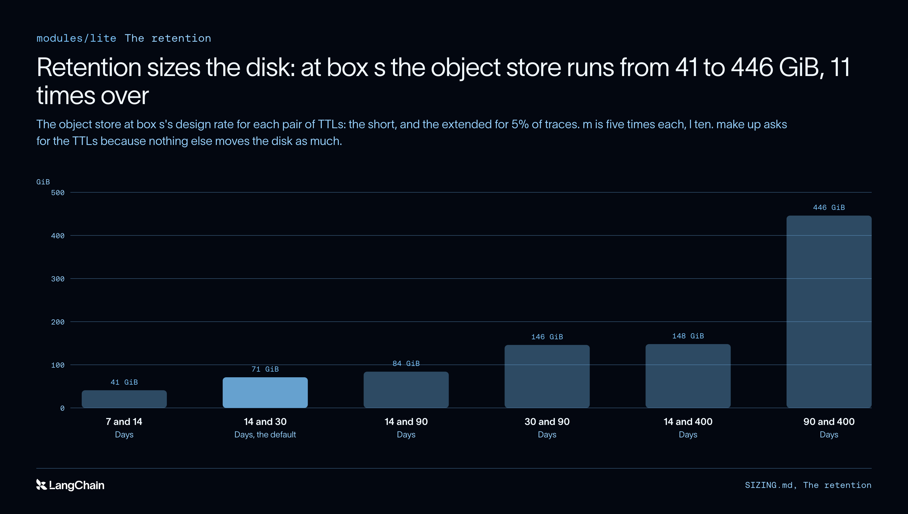

# Sizing

> **Status:** current · **Last verified:** 2026-11-27 (plan output at each size; every size measured twice on one box)

Every pod and volume follows from two choices: the load (`box`, or `runs_per_second`) and the retention
(`short_ttl_days`, `long_ttl_days`). The data is [`infra/sizes.yaml`](infra/sizes.yaml), the arithmetic
[`infra/sizing.tf`](infra/sizing.tf), whose blocks follow this page's computation in order and by name.
`make plan` prints the result and refuses a machine that cannot hold it, before any machine exists. The
numbers come from two experiments that took every size to three times its design rate
([What the experiments measured](#what-the-experiments-measured)).

## The computation

```
inputs   peak runs/s, readers, short and long TTL, extended %, payload mix, storage_factor, the machine

# pods: LangSmith's from the measured model; the rest per box, or fixed
for each LangSmith service s:                               # ace-backend only with code_evaluators
    s.cpu = max(50m, (s.idle + s.per_unit x s.work) x 1.5)  # work: runs/s, readers, or none
    s.mem = s.measured_peak x 1.2                           # limit: 2x, at least 256 MiB above
SmithDB = per box, its memory request = its limit           # it divides its limit among its parts
Postgres, RustFS = per box                                  # Redis below; observability, Mission Control fixed

# what a run costs (decimal KB), weighted by the mix: 70% small, 25% medium, 5% large
kb = { smithdb: 12.0, blob: 13.7 + attachments, redis: 8.1 }   # redis: a run waiting for ingest

# the volumes: storage fills at the average, and keeps each run its TTL
runs_a_day      = peak / 3 x 86,400
smithdb_days    = 95% x (short + 5) + 5% x (long + 5)       # SmithDB deletes about 5 days after the TTL
blob_days       = 95% x short + 5% x long                   # extended_retention_pct = 5
object_store    = runs_a_day x (kb.smithdb x smithdb_days + kb.blob x blob_days) x storage_factor x 1.2
smithdb_cache   = max(10 GiB, runs_a_day x kb.smithdb x query_hot_days x 1.2)
redis.maxmemory = max(256 MiB, peak x (2.5 KB x run expiry + kb.redis x 1 h) x 1.3)
                                                            # a record a run for the expiry, and an hour of
                                                            # a stalled ingest's payloads (Redis, below)
redis.memory    = maxmemory / 0.75                          # request = limit: reserved
postgres.max_connections = round up to 50 of (2 API pods x 50 + 2 workers x 3 + 20) / 0.8, at least 100

# the fit
allowed   = (machine - reserved for k3s) x 0.85             # CPU and memory
requested = every pod's request                            <= allowed
volumes   = object_store + cache + Redis + Postgres + Prometheus
          <= 80% of the data disk, or volumes + 40 GiB system <= 80% of the one disk
                                                            # k3s evicts under 15% free, cleans images at 80%
peak      <= 50 runs/s                                      # past it: a full deployment
```

## The sizes


At the default TTLs (14 days, 30 extended), each size at its design rate:

| `box` | Machine | Peak runs/s | Runs a day | Requests of allowed | Volumes | Object store | Redis maxmemory |
|:--|:--|--:|--:|:--|--:|--:|--:|
| `xs` | 2 vCPU, 16 GiB, 100 GiB | 1 | 28,800 | 1.30 of 1.36 vCPU, 9.1 of 12.8 GiB | 36 GiB | 15 GiB | 256 MiB |
| `s` | 4 vCPU, 32 GiB, 200 GiB | 5 | 144,000 | 2.19 of 2.98 vCPU, 13.4 of 25.9 GiB | 106 GiB | 71 GiB | 516 MiB |
| `m` | 8 vCPU, 64 GiB, 640 GiB | 25 | 720,000 | 4.05 of 6.16 vCPU, 23.9 of 52.7 GiB | 465 GiB | 354 GiB | 2.5 GiB |
| `l` | 16 vCPU, 64 GiB, 1,280 GiB | 50 | 1,440,000 | 7.02 of 12.75 vCPU, 40.7 of 51.8 GiB | 939 GiB | 708 GiB | 5.0 GiB |

LangSmith's services ask their measured memory peak x 1.2 and their CPU x 1.5, and the box lets requests
reach 85% of what k3s leaves allocatable, so a request is the buffer on a measurement and the box keeps
15% more on top. `xs`, `s` and `m` keep 8 GiB a vCPU: SmithDB reserves the memory it divides among its
parts, and on a 16 GiB machine `s`'s 13.4 GiB of requests would pass the 12.3 GiB it allows. A run is one
span: a trace of 10 LLM and tool calls at one trace a second is 10 runs/s. `l` stops at 50 runs/s,
LangChain's sizing calculator's limit for one machine; past it the plan refuses and points at a full
deployment ([`../aws`](../aws), [`../gcp`](../gcp), [`../azure`](../azure), [`../baremetal`](../baremetal)).
`xs` runs no observability stack or Mission Control of its own (an install a fleet watches from one
stack), which is what fits it in 2 vCPU.

Each size held its design rate in realistic traces, and some held more: `xs` and `m` 3 times it, `s` and
`l` once, both missing on reads, not on writes ([SmithDB's merges](#smithdbs-merges)). The design rate is
the rate to plan for; the rest is headroom for a burst, not a second size.

## The cost

On AWS, at us-east-1 on-demand list prices (`infra/sizes.yaml`, read 2026-11), a month of 730 hours:

```
instance  = the size's type, hourly x 730               # or aws_hourly_usd, a negotiated price
disks     = (40 GiB system + data disk) x $0.08 gp3     # data disk = the volumes / 0.8, rounded up to 10 GiB
snapshots = the volumes x $0.05                         # incremental; the volumes bound them
address   = $0.005 x 730                                # the instance's fixed public address
```

| `box` | Instance | Instance | Disks | Snapshots | Address | Total |
|:--|:--|--:|--:|--:|--:|--:|
| `xs` | r7i.large | $96.58 | $7.20 | $1.80 | $3.65 | about $110 |
| `s` | r7i.xlarge | $193.16 | $14.40 | $5.30 | $3.65 | about $217 |
| `m` | r7i.2xlarge | $386.32 | $50.40 | $23.25 | $3.65 | about $464 |
| `l` | m7i.4xlarge | $588.67 | $97.60 | $46.95 | $3.65 | about $737 |

`make plan` prints the same for the box it plans, rounded up to the dollar. A machine of your own, or one
in another cloud, costs what you pay for it: the shape is what matters (Azure's E2s, E4s and E8s v5 and
D16s v5, and Google Cloud's n2-highmem-2, -4 and -8 and n2-standard-16, have the vCPUs and memory of
`xs` to `l`).

## What runs on box `s`


| Pod | What it does | CPU | Memory (limit) |
|:--|:--|--:|--:|
| platform-backend | Go: the ingest API and auth | 50m | 308 MiB (616 MiB) |
| ingest-queue | Go: runs from Redis into SmithDB | 90m | 768 MiB (1.5 GiB) |
| queue | Python: LangSmith's background worker | 195m | 1.3 GiB (2.6 GiB) |
| backend | Python: the API the UI reads | 50m | 1.1 GiB (2.3 GiB) |
| frontend | the UI, and the nginx in front of every request | 66m | 154 MiB (410 MiB) |
| SmithDB | one pod: ingestion, queries, compaction | 750m | 6 GiB, reserved |
| Redis | runs waiting for ingest-queue, a record of each run, the queues | 50m | 688 MiB, reserved |
| Postgres | LangSmith's database and SmithDB's metastore | 100m | 768 MiB, reserved |
| RustFS | the object store: SmithDB's bucket and the blob bucket | 100m | 1 GiB (3 GiB) |
| Prometheus, Grafana, 4 collectors | observability | 190m | 880 MiB |
| Mission Control (2 pods) | health and diagnostics; strictly read-only | 350m | 384 MiB |
| CoreDNS, metrics-server | k3s's own | 200m | 140 MiB |
| **Total** | | **2.19 vCPU** | **13.4 GiB** |
| ace-backend | custom code evaluators | off: `code_evaluators = true` runs it | |

The other sizes scale the same rows; `make plan` lists every pod. ingest-queue asks 90m but keeps a
2-CPU limit: it starts as many workers as its limit allows, so a smaller limit backlogs with the CPU idle.

## What the chart runs, and what Lite keeps

At chart 0.18, the chart's defaults against what Lite renders (`make render`; the plan lists the sizes):

| Chart default | Lite | Why |
|:--|:--|:--|
| platform-backend x3, ingest-queue x3, backend x2, frontend, queue | one each, sized from the rate or the readers | the tracing path; one box has no second node to spread onto |
| ClickHouse | off | SmithDB is the trace store at 0.18 |
| SmithDB as separate services (ingestion, query, compaction and its workers, a cluster manager, and stats-query, mutations and run rules where enabled) at the `small` tier | one unified pod, below that tier, merging every 4 minutes | one process for one machine's load ([SmithDB's merges](#smithdbs-merges)) |
| Insights and Polly, each with its own Postgres and Redis | off | products beyond tracing |
| playground | 0 replicas, always | prompts against model providers, not tracing |
| ace-backend | 0 replicas; `code_evaluators = true` runs it | runs custom code evaluators only; nothing on the tracing path calls it |
| the operator, Fleet's tool and trigger servers | off | LangGraph deployments and Fleet |
| the chart's e2e test pod | off | the chart's own CI |
| migrations, auth bootstrap, backfill check (Jobs) | kept | they set up the database and the first admin |

Kept, in order of what they would save on box `s`:

- **Mission Control** (350m, 384 MiB, about 16% of `s`'s CPU requests): strictly read-only, a health
  view and a diagnostics bundle. `mission_control = false` drops it; the health dashboard covers the same
  signals.
- **queue** (195m, 1.3 GiB): LangSmith's Python background worker, measured at 0.13 cores and 1.0 GiB
  at every rate from 1 to 150 runs/s. The chart has no switch for it.
- **The observability stack** (190m, 880 MiB): what makes the alerts. `observability = false` drops it, as
  `xs` and a cluster do, when a shared stack watches the box.
- **SmithDB's query cache**: `query_hot_days` (7) sizes it; 3 days halves it where traces are read soon
  after they arrive.

## Each store

| Store | Holds | Grows with | Bounded by | Size |
|:--|:--|:--|:--|:--|
| RustFS, SmithDB's bucket | SmithDB's segments | runs a day x 12.0 KB | SmithDB's deletes, about 5 days after the TTL | `object_store` |
| RustFS, blob bucket | payloads of 20 KiB or more, attachments | runs a day x 13.7 KB | expiry rules on `ttl_s/`, `ttl_l/`; abandoned uploads aborted | `object_store` |
| SmithDB's query cache | recent segments, so reads skip RustFS | `query_hot_days` of writes | its volume | `smithdb_cache` |
| Redis | a run's payload until ingested, then a small record of it; the queues | the rate x the run expiry; a backlog | `maxmemory`, `noeviction` | `redis.maxmemory` |
| Postgres | orgs, projects, keys; SmithDB's segment metadata | use; the rate x the retention | compaction removes expired metadata | per box: 10, 10, 20, 50 GiB |
| Prometheus | metrics | `prometheus_retention_days` | `retentionSize`, four fifths of its volume | per box: none, 10, 20, 40 GiB |

Every volume is a folder on the data disk (k3s's local-path), not a quota; the plan keeps their sum
within 80% of the disk (the computation, the fit), and the health dashboard turns orange at 80% of each
disk and alerts at 90% ([OPERATE.md, Watching it](OPERATE.md#watching-it)).

**Redis.** Through chart 0.17, a run's payload stayed in Redis for the whole run expiry (6 hours by
default) after it was stored, so Redis had to hold every payload of the last 6 hours: 8.1 KB a run at
the peak, the 14 GiB this plan once reserved at box `l`. From 0.18, with ClickHouse off as Lite runs it,
ingest deletes a run's payload once the run is stored and keeps a small record of it until the expiry,
so late feedback can still find its run. On one machine that record is 1.6 to 1.7 KiB a run, the same
whether a run carries 34 KiB or 97 KiB; LangChain's own load test at 20,000 to 200,000 runs a second
measured about 2.5 KB. Lite plans the larger, for the expiry, and adds an hour of the peak's payloads
for an ingest that stops: a SmithDB restart or an object store outage fills Redis at the rate runs
arrive, and an hour of that is far longer than any drain measured (the oldest queued task waited at most
59 s). Redis evicts nothing: full, it refuses new runs, which the SDK retries. Lowering
`redis_runs_expiry_hours` shrinks the record term; a backlog older than the expiry loses its runs.

**SmithDB's memory.** One SmithDB pod divides its memory limit among its parts: 40% the query pool, 25%
compaction, 20% ingest, 10% the query cache, the rest for the runtime. It grows toward that limit as its
caches fill (box `s` held 4.6 GiB of its 6 after 48 minutes), so the limit is the size, and the plan
reserves it.

## SmithDB's merges

SmithDB writes what it ingests as small segments, one about every second for each partition (a project
on a day), and merges a partition's segments into one larger, L1 segment when either comes first: a
timer, or 25,000 rows. Until then every read of that partition scans every small segment, and a read
slows as they pile up:

| Most segments waiting in a step | Steps | Opening a trace, p99 |
|:--|--:|:--|
| under 300 | 10 | 0.07 to 2.0 s |
| 300 to 420 | 10 | 0.7 to 3.3 s |
| 420 to 527 | 8 | 0.5 to 17.8 s; four past the 5 s target |

Every step that read slower than 5 s had more than 420 waiting; not every step with that many was
slow, as the reads that land just after a merge are fast.

SmithDB's own timer is 10 minutes plus up to 3 minutes at random, checked every minute: at a few runs a
second the pile grows for 11 to 14 minutes, to about 500, before it merges, and at box `s` the merge of
that pile stalled ingest for a minute, which is when ingest-queue's backlog formed (up to 94 tasks, the
oldest 59 s). At high rates the 25,000 rows come first and the pile stays smaller, which is why
`m` held 3 times its rate and `s` did not hold 2. A query that would scan more than 10,000 partitions is
refused (HTTP 429), which protects SmithDB's memory: at `l`, 2x, 80 trace reads were.

Lite merges every 4 minutes, with 30 seconds of jitter, checked every 30 seconds, and writes a small
segment at most every second (`smithdb_merge`), which bounds the pile near 300 at any rate. The cost is
more L1 segments for SmithDB's compaction to combine later; at Lite's rates its queue never held a
pending job. LangChain's SmithDB team set the same 4-minute timer for a larger LangSmith whose segments
piled up, in 2026-11.

## The retention

The TTLs size the disk more than anything else, so `make up` asks for them, and a plan made without them
says so on every run. The object store at box `s` (box `m` is five times each, `l` ten):



| TTLs, days (short / extended) | 7 / 14 | 14 / 30 | 14 / 90 | 30 / 90 | 14 / 400 | 90 / 400 |
|:--|--:|--:|--:|--:|--:|--:|
| Object store | 41 GiB | 71 GiB | 84 GiB | 146 GiB | 148 GiB | 446 GiB |

Every number assumes 5% of traces on extended retention (`extended_retention_pct`). In realistic traces
the object store held 29 KB a run at rest against the 25.7 KB budgeted ([What the experiments
measured](#what-the-experiments-measured)); real text can take more (`storage_factor`). The chart refuses
a long TTL under 14 days, and so does the plan.

## What the experiments measured

`make experiment` installs each size from no data on one machine, holds every pod to the size's machine
(`emulate_machine`), and soaks it ten minutes a step; `make compare` draws every experiment on one scale.
Two ran on one server (a 32-core Threadripper, 93 GiB, a PCIe 5 NVMe), chart 0.18, on 2026-11-26: the
load test's simple traces at 1, 2 and 3 times each size's design rate, then agent traces, shaped and
sized as an application's are (the load test's README, Agent traces), at 1 twice, 2 and 3 times.

- **Nothing was lost:** all 700,309 runs sent were stored, with no restart and no pod killed for memory.
- **The services follow the rate in a straight line, at a fraction of what was planned:** ingest-queue
  6.9 millicores a run/s in simple traces and 4.0 in agent traces, against 35 planned; platform-backend
  1.0 against 4.5; queue flat at 0.13 cores. The plan now uses the heavier of each.
- **Redis held a record, not a payload:** 1.56 to 1.73 KiB a run across 28 steps, against the 8.1 KB a
  run the plan held for 6 hours ([Each store](#each-store)). Redis used 0.4 GiB at most, of 14 reserved.
- **Every pod together used at most 58% of a size's vCPU** in its busiest minute and 27% of its memory.
  The busiest minutes were a fresh install's first (Postgres takes up to 1.6 cores for ten minutes, then
  0.02 to 0.05) and the minute before a merge, when SmithDB's reads of the pile took up to 1.75 times
  its CPU request.
- **Reads slowed before anything else,** with the pile of segments waiting to merge, not with the
  machine ([SmithDB's merges](#smithdbs-merges)).
- **SmithDB's memory climbed toward its limit** at `s` (4.6 of 6 GiB); at `m` and `l` it stayed under
  half. RustFS peaked at 0.8 GiB at `s`, past its 768 MiB request, and at 1.2 GiB at `m` and `l`.
- **A run kept 29 KB at rest in agent traces** on box `l` (blobs 14.3, SmithDB's segments 14.8), within
  the 25.7 KB budgeted x 1.2; the simple traces' one large field a side kept 89 to 120 KiB.
- **The first 1x after a fresh install is not slower by a rule:** a second 1x on the same install moved
  lag up or down by as much as 2.7 times; ten minutes is one sample, not a distribution.

What the plan changed, with these runs cited (`infra/sizes.yaml`):

| | Before | Now |
|:--|:--|:--|
| ingest-queue, a run/s | 35 millicores, 1.3 GiB | 7 millicores, 768 MiB; its 2-CPU limit kept |
| platform-backend, a run/s | 4.5 millicores, 615 MiB | 1.3 millicores, 308 MiB |
| queue | 82 millicores + 5.8 a run/s, 1.9 GiB | 130 millicores flat, 1.3 GiB |
| Redis maxmemory at `s`, `m`, `l` | 1.1, 5.3, 10.6 GiB | 0.5, 2.5, 5.0 GiB |
| SmithDB's memory request at `s`, `m`, `l` | 3, 8, 16 GiB | 6, 12, 24 GiB: its limit |
| RustFS's memory request at `s`, `l` | 768 MiB, 4 GiB | 1 GiB, 2 GiB |
| SmithDB's merge timer | 10 minutes + up to 3 | 4 minutes + up to 30 s |

What these runs cannot say: each core is a desktop Threadripper's, faster than a cloud vCPU; the disk is
a PCIe 5 NVMe, never held to a cloud disk's throughput; and ten-minute steps show neither the object
store after a TTL's expiry nor SmithDB's memory after hours. The next experiment runs this plan the same
way, so the three compare step for step.

| Number | Source |
|:--|:--|
| LangSmith's services (idle and per-unit cores, memory) | the two experiments above; frontend and backend, which follow readers, the bare-metal lab (2026-10-31, 2026-11-01, Reed Bender) |
| The 2-CPU limit on the Go services | ingest-queue throttled in 98% of periods under 1 CPU at 4.3 traces/s (2026-10-22; terraform#513, Michael Frederick); its workers follow the limit (Dzmitry Dubarau, 2026-10-12) |
| What a run costs in each store | LangChain's trace payload measurements and load tests of LangSmith 0.17.6 with SmithDB (2026-11, Dzmitry Dubarau) |
| Redis's record a run, the hour of payloads | the experiments above; LangChain's load test at 20,000 to 200,000 runs/s; the sizing calculator's `redis.trimmed_kb_per_run` and `redis.stall_hours` |
| SmithDB's memory shares, merge timer, row trigger, fanout limit | SmithDB's source (v18): `smithdb all`'s memory budget, the ingestion config's defaults, the query fanout limit |
| Peak factor 3, headroom 1.2, Redis 1.3, the connection budget, 50 runs/s on one machine | LangChain's sizing calculator ([`utils/langsmith-sizing`](../../utils/langsmith-sizing)) |
| SmithDB, Postgres, RustFS per box | the bare-metal module's tested profiles; RustFS's 6 GiB limit at `m` from the lab, where 2 GiB was OOM-killed 9 times at 70 to 80 traces/s: headroom, not a measured need |

Lite and the calculator share the services' payload costs, the peak factor, Redis's model and headroom,
the connection formula and the single-machine limit. They differ on purpose in two places: Lite's
extended TTL is 30 days, not the chart's 400 (a single disk stays bounded), and SmithDB runs as one pod
below the chart's smallest tier, with the metastore a second database in the one Postgres.

## Settings

| Setting | Default | Drives |
|:--|:--|:--|
| `box`, `machine` | `s`, the size's | the design load and every per-box size; `machine` for a box of another shape |
| `runs_per_second`, `readers` | the size's | LangSmith's pods, the object store, Redis |
| `short_ttl_days`, `long_ttl_days` | asked; 14 and 30 | LangSmith's TTLs, SmithDB's retention, the bucket's expiry rules, the object store |
| `extended_retention_pct` | 5 | the share of traces kept for the long TTL |
| `payload_mix_pct`, `storage_factor`, `attachment_kib_per_run` | 70/25/5, 1, 0 | what a run costs |
| `query_hot_days` | 7 | SmithDB's query cache |
| `smithdb_merge` | 1,000 ms, 4 minutes, 30 s | how often SmithDB writes a small segment, and merges a partition's ([SmithDB's merges](#smithdbs-merges)) |
| `redis_runs_expiry_hours` | 6 | how long a run waits for ingest before it is dropped, and its record kept; Redis's memory |
| `postgres_max_connections` | derived (200) | Postgres's connection limit |
| `max_payload_mb`, `blob_min_kb` | 25, 20 | the largest request; the size a payload goes to RustFS at |
| `prometheus_retention_days` | 15 | days of metrics |
| `observability`, `mission_control` | on, but off at `xs` and on a cluster | the stack on the box |
| `code_evaluators` | off | ace-backend, for custom code evaluators |
| `resources`, `volumes`, `max_request_ratio` | none, none, 0.85 | a measured size in place of a computed one; the share of the machine pods may request |
| `emulate_machine` | off | bare metal: every pod together held to the size's machine less its reservation, to measure a smaller size on a larger box (`make experiment` sets it for its own installs) |
