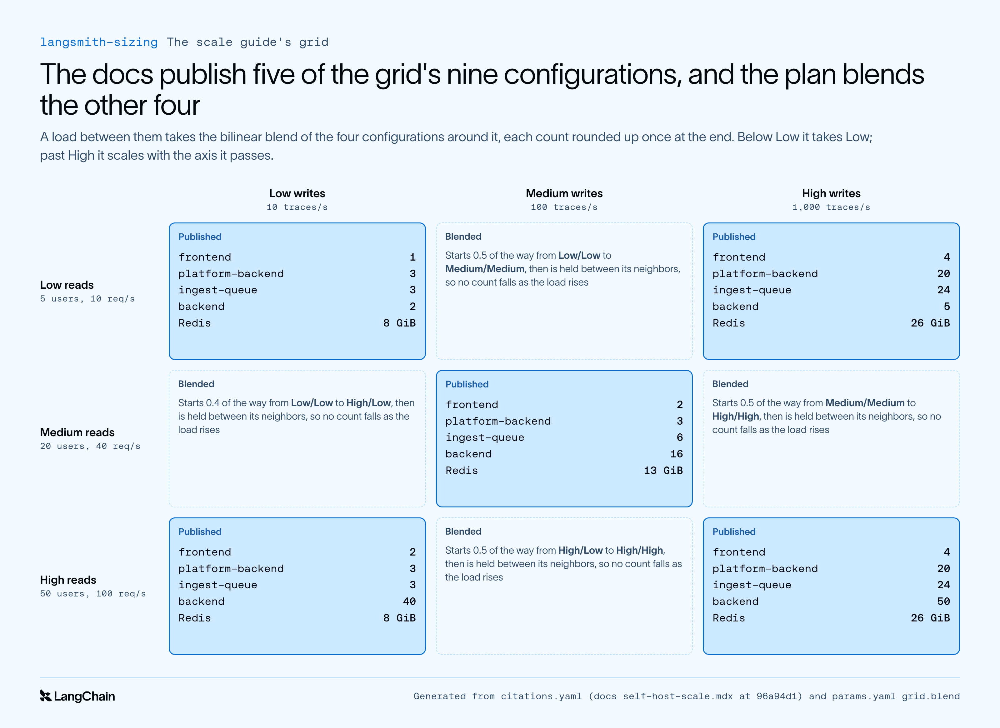

# How a plan is sized

> **Status:** current. The chart versions are in [`charts.yaml`](../charts.yaml) and the docs commit in
> [`citations.yaml`](../citations.yaml). The tables marked generated are written by `make reference`, and
> the tests fail when they drift.

Every number in a plan comes from one of five places, and only one of them is this package's own. The
chart and the public docs are canon: the plan reads the chart at the version you install and quotes the
docs by commit, and it never restates either. Your inputs describe the load. Measurements from a running
install are compared with a plan and never stored in it. What is left, the constants no chart value or
docs page gives, are the parameters in `params.yaml`, and each one carries its unit, the reason it exists,
its source, who set it and when.

<picture>
  <source media="(prefers-color-scheme: dark)" srcset="figures/how-it-works-dark.png">
  
</picture>

| Source | Gives | How it is read | When they disagree |
|:--|:--|:--|:--|
| The Helm chart | every default: requests, limits, replica counts, autoscaler blocks, SmithDB's per-tier pod sizes, Redis expiry | rendered with `helm template` at the version planned (`chart.py`) | the chart wins: a parameter that restates a chart value fails `make params` |
| The public docs | the scale guide's five configurations, SmithDB's tiers, store requirements, the backfill rate | quoted by file, commit and exact text in `citations.yaml` | the docs win: a quote the docs no longer carry fails `make citations` |
| Inputs | the load and the shape of the install | flags, the wizard, or a preset in `presets/` | yours win: a flag replaces the preset's value |
| Parameters | the model's own constants, in `params.yaml` | refused at load without unit, why, source, author and date | a parameter may override a chart default only by naming the `chart_key` and saying why |
| Measurements | what a running install reports | `compare` sets a load test's results against the plan | a measurement that should change sizing becomes a parameter, with the run as its source |

Where a regime changes what the bands alone would size (the low regimes' single replicas and SmithDB
layout, scale-out's measured rates), the plan holds the figures the regime gave, and `smithdb.auto` keeps
the tier the bands picked. Every citation and every parameter is listed in [parameters.md](parameters.md).

## The published profiles it builds from

### The scale guide

The docs' [scaling guide](https://docs.langchain.com/langsmith/self-host-scale) publishes five
configurations of a reads by writes grid. Reads are counted in concurrent frontend users, writes in traces
a second. These are the replica counts and stores the plan starts from:

<!-- generated:scale-guide -->
| Published configuration | frontend | platform-backend | ingest-queue | backend | Redis GiB | ClickHouse |
|:--|:--|:--|:--|:--|:--|:--|
| Low reads (5 users), Low writes (10 traces/s) | 1 | 3 | 3 | 2 | 8 | 4 vCPU, 16 GiB |
| Low reads (5 users), High writes (1,000 traces/s) | 4 | 20 | 24 | 5 | 26 | 10 vCPU, 32 GiB |
| High reads (50 users), Low writes (10 traces/s) | 2 | 3 | 3 | 40 | 8 | 8 vCPU, 16 GiB |
| Medium reads (20 users), Medium writes (100 traces/s) | 2 | 3 | 6 | 16 | 13 | 16 vCPU, 24 GiB |
| High reads (50 users), High writes (1,000 traces/s) | 4 | 20 | 24 | 50 | 26 | 14 vCPU, 24 GiB |
<!-- /generated:scale-guide -->

The guide publishes five of the grid's nine nodes. The other four are blended from their published
neighbors and then clamped between them, so that no count falls as the load rises: the guide's own
Medium/Medium runs 3 platform-backend replicas where Low reads/High writes runs 20, and a straight blend
would let a heavier load get fewer pods.

<picture>
  <source media="(prefers-color-scheme: dark)" srcset="figures/scale-grid-dark.png">
  
</picture>

### SmithDB's tiers

The docs' [SmithDB scaling page](https://docs.langchain.com/langsmith/self-host-smithdb-scale) publishes
three tiers, each rated at a tested ingest and query rate. The per-pod CPU, memory and cache come from the
chart's tier helper at the version planned (`smithdb.resourceTier`), never from this table; the tier a
load needs is the model's choice, from the peak write rate in runs a second and the read rate.

<!-- generated:smithdb-tiers -->
| Tier | Tested ingest / query QPS (docs) | Peak runs/s (model's band) | ingestion | query | compaction | compaction-worker | cluster-manager | Metastore (docs) |
|:--|:--|:--|:--|:--|:--|:--|:--|:--|
| small | 10 / 10 | below 100 | 1 | 1 | 1 | 1 | 1 | 2 vCPU, 16 GiB |
| medium | 100 / 40 | below 1,000 | 1 | 1 | 1 | 1 | 1 | 4 vCPU, 32 GiB |
| large | 1,000 / 100 | below 10,000 | 2 | 4 | 1 | 4 | 1 | 8 vCPU, 64 GiB |
<!-- /generated:smithdb-tiers -->

The tiers' QPS is batched ingest requests, while every measured limit is in runs a second, so the model
keeps its own band edges in runs a second (`smithdb.peak_runs_bands`), from field cases.

## The formulas, stage by stage

Each stage is a pure function in `src/langsmith_sizing/model/`: numbers in, numbers out. The worked figures
are the `lite` preset (5 users, 5 traces/s on average, 15 at the peak, 10 runs a trace), read from
`uv run langsmith-sizing size --preset lite` and the same on either chart in `charts.yaml`.

### 1. Rates

```
runs/s average = traces/s x runs a trace
runs/s peak    = peak traces/s x runs a trace        (when you know your busiest hour)
               = runs/s average x load.peak_factor   (when you do not; the factor is 3)
runs a day     = runs/s average x 86,400
```

`lite` is 50 runs/s on average, 150 at the peak and 4.32 million a day. Storage is sized on the average,
because bytes accumulate at the average rate; Redis, ingest and SmithDB are sized on the peak, because that
is when they fall behind. `model/load.py: run_rates`.

### 2. Regime

The regime is the kind of load, and it decides what the plan turns on. The bands are data in
`params.yaml` and the first that holds wins, tested from the largest down, so a few traces a second of
huge traces is still a large write rate.

<!-- generated:regimes -->
| Regime (tested in this order) | Holds when | Turns on | Unmeasured |
|:--|:--|:--|:--|
| `beyond-tested` | everything else | autoscalers: on, splits: on, redis_cluster: on, queue_partitions: on, separate_node_pools: on, ceilings_above_chart_default: on, scale_out: on, warn_beyond_tested: on, watch_object_store_request_rate: on, payloads_in_redis_when_offload_throttled: on |  |
| `scale-out` | peak at or above 10,000 runs/s | autoscalers: on, splits: on, redis_cluster: on, queue_partitions: on, separate_node_pools: on, ceilings_above_chart_default: on, scale_out: on, watch_object_store_request_rate: on, payloads_in_redis_when_offload_throttled: on |  |
| `large` | peak at or above 1,000 runs/s | autoscalers: on, splits: on, redis_cluster: on, queue_partitions: on, separate_node_pools: on, ceilings_above_chart_default: on |  |
| `extra-lite` | peak at or below 5 traces/s, survives_node_loss is off | autoscalers: off, serving_replicas: 1, clickhouse: off, smithdb_tier: small, smithdb_unified: on, stores_in_cluster: on, one_node: on, short_retention: on, tracing_only: on, hook_jobs_set_node_peak: on, requests_from_measured: on |  |
| `lite` | peak at or below 15 traces/s | autoscalers: on, nodes: 2, smallest_managed_stores: on, smithdb_tier: small, smithdb_unified: on | yes |
| `standard` | everything else | autoscalers: on |  |
<!-- /generated:regimes -->

<picture>
  <source media="(prefers-color-scheme: dark)" srcset="figures/regimes-dark.png">
  
</picture>

`model/regime.py: classify`. The low regimes' edges are peak traces a second; the high ones are peak runs a
second, at SmithDB's band edges.

### 3. The scale guide's replicas

```
position on an axis = 0 at or below Low, 1 at Medium, 2 at or above High, linear between
replicas            = bilinear blend of the four grid nodes around (reads, writes), rounded up once
past High           = the High figure x (users / 50) for frontend and backend,
                                     x (traces/s / 1,000) for platform-backend, ingest-queue and Redis
```

Below Low the plan takes Low: the smallest published configuration is a floor, never scaled down. `lite`
is inside the Low/Low corner, so it takes 1 frontend, 3 platform-backend, 3 ingest-queue and 2 backend
replicas from the guide before the payload model below raises any of them. `model/load.py: build_grid,
grid_profile, profile_for`.

### 4. Payload: what a run costs in each store

LangChain measured three run sizes (8, 64 and 1,500 KiB a run) and what each costs in SmithDB, in the
LangSmith blob bucket, in Redis and in platform-backend pods. Between them the cost follows a power law
(a straight line on log-log axes); outside them it holds the end's value or the end's ratio. A mix of the
three (70% small, 25% medium, 5% large by default) blends them by weight:

```
KB a run, per store = sum over sizes of (share x that size's KB)
```

`lite` blends to 11.975 KB a run in SmithDB, 13.7 KB in the blob bucket and 8.115 KB in Redis. A field
at or above the offload threshold (20 KiB) goes to the blob bucket, and Redis then holds a pointer
instead of the body. `model/payload.py: resolve`; the measurements are `payload.*` in `params.yaml`.

### 5. Ingest queue

```
runs/s a core = run-weighted harmonic mean of the measured rate at each run size
CPUs          = peak runs/s / runs a core x ingest.cpu_headroom (1.25)
pods          = max(ingest.min_pods (2), ceil(CPUs / ingest.pod_cpu (2)))
floor         = the same at the average rate
KEDA ceiling  = the nearest multiple of 5 to pods x 1.5, never below pods
```

The mean is harmonic because a large run holds a core longer: the times add, not the rates. `lite` gets
34.9 runs a second a core, 5.4 CPUs at the peak, 3 pods of 2 vCPU, a floor of 2 and a KEDA ceiling of 5.
The pods run at 2 vCPU, requests equal to limits, where the chart requests 1, because a lab run held lag
under 3 s with three 2-CPU pods where one 1-CPU pod ran 277 s behind. `model/services.py: ingest`.

### 6. platform-backend and backend

```
platform-backend = max(the guide's figure, ceil(peak runs/s / 1,000 x pods a 1,000 runs/s), the chart's default)
backend          = the guide's figure, or the chart's default when SmithDB serves reads
```

The payload term is a floor under the guide, never a cap. When SmithDB serves reads, the Python backend is
off the read path, and the guide's backend curve was measured with ClickHouse serving them, so it does not
apply. `model/services.py: application_replicas`.

### 7. SmithDB

```
write tier  = the first tier whose band the peak runs/s is below
read tier   = the first tier whose tested query QPS covers users x 2 requests/s
tier        = the larger of the two
```

Two requests a second a user is the scale guide's own ratio (100 requests a second at 50 users). From the
medium tier up the query service keeps at least two replicas, so one serves through a rollout; reads raise
the tier, never the query count, because each query pod holds its own cache and more pods split it.

`lite` reads at 10 requests a second, inside small's tested 10, but its 150 peak runs a second is past
small's band of 100, so the bands alone pick medium: two 28 vCPU query pods. The low regimes keep small and
scale it out instead, because one small ingestion pod was measured to hold 86 runs a second (and was
OOM-killed from 113) and at this volume the data fits one query pod's cache:

```
ingestion pods = ceil(peak runs/s / smithdb.small_ingestion_runs_per_pod (86))
query pods     = ceil(query requests/s / small's tested query QPS (10))
unified        = both are 1, the chart has smithdb.topology (0.18), and you did not choose a layout
```

`lite` runs two ingestion pods and one query pod on the small tier. The bands' choice is kept in the plan
under `smithdb.auto`, and a tier or layout you give with `--smithdb-tier` or
`--smithdb-topology` is kept as you gave it. `model/smithdb.py: auto_tier, low_regime_layout`.

### 8. Object storage

```
TB             = runs a day x KB a run x 1,000 x days kept x headroom.storage (1.2) / 10^12
SmithDB days   = (1 - extended share) x (base TTL + 5) + extended share x (extended TTL + 5)
blob days      = (1 - extended share) x base TTL + extended share x (extended TTL + base TTL)
blob KB a run  = offloaded KB a run + attachment KiB a run x 1.024
```

SmithDB deletes 5 days after a run's TTL (`retention.smithdb_delete_lag_days`). An upgrade to extended
retention writes a second `ttl_l/` copy of an offloaded field beside the `ttl_s/` one, so the extended share
lives for both TTLs in the blob bucket. `lite` (14 days base, 5% extended to 400) needs 2.38 TB for SmithDB
and 2.41 TB for the blob bucket. Attachments (`--attachment-kib-per-run`) go to the blob bucket at the
bytes sent, beside offloaded fields and for the same days; SmithDB keeps a pointer to them, not the bytes
(the [blob storage docs](https://docs.langchain.com/langsmith/self-host-blob-storage) list attachments among
what the bucket holds; that they are stored as sent is the model's reading). `attachments_tb` is their part.
`model/stores.py: object_storage`.

### 9. Redis

```
bytes    = peak runs/s x Redis KB a run x 1,000 x expiry seconds x headroom.redis (1.3)
shards   = ceil(peak runs/s x (inline share / 850 + offloaded share / 1,700))
alarm at = maxmemory x redis.alarm_pct (70%)
```

Every run stays in Redis for the full expiry (six hours by default), even after it is ingested, so Redis is
sized on the peak and the expiry is never shortened to save memory: a backlog that outlives it loses runs.
`lite` needs 150 x 8.115 x 1,000 x 21,600 x 1.3 = 34.2 GB, so 32 GiB, with the alarm at 22.4 GiB and one
shard. Redis is single-threaded, so the shard count follows the run rate; past one shard or one managed
node's memory (300 GB) it must be a cluster with queue partitions. `model/stores.py: redis_bytes,
redis_shards_for_cpu`.

### 10. Postgres connections

```
connections = (platform-backend + backend pods) x 50 + (queue + ingest-queue pods) x the chart's ASYNCPG_POOL_MAX_SIZE
budget      = max_connections x 0.8
```

`lite` opens 5 x 50 + 4 x 3 = 262 connections. An external instance's `max_connections` is estimated with
the RDS parameter-group formula (memory / 9,531,392, at most 5,000) as a stand-in for every cloud: confirm
it against the instance. `model/stores.py: postgres_connections, postgres_max_connections`.

### 11. Totals and node pools

```
nodes = max(ceil(CPU requests x pools.overhead (1.2) / node vCPU),
            ceil(memory requests x 1.2 / node GiB),
            the pool's floor)
```

Each total is read three times: at the autoscalers' floors, at the sized replicas and at their ceilings.
A pod fits a node only strictly below the node's shape, because the kubelet and system pods take part of
every node. The node shape (8 vCPU, 32 GiB for applications by default) is a counting unit, not a
provisioning instruction: give your own with `--app-node`. `model/totals.py: pool, node_count`.

### 12. A SmithDB backfill

```
vCPUs       = historical runs / 5,000,000 / days to finish     (the docs' migration page)
pods        = ceil(vCPUs / the migration Job's CPU a pod)
pod memory  = at least 32 GiB, whatever the CPU                (the docs' practical minimum)
```

The backfill runs beside the serving pods until it finishes and is sized apart from the tier, and only
when you give `--backfill-runs` and `--backfill-days`. `model/smithdb.py: backfill`.

## Advanced

Three stages that apply only when you choose products, or when the load is at an extreme.

### 13. Products beside tracing

An install can run Agent Server, Fleet, Insights, Chat (Polly), Engine, the LLM gateway and Sandboxes
beside tracing (`--products`, `PRODUCTS=`, or the wizard's Products question). What each turns on in the
chart, what it requires and what the cluster must have for it is data, in [`products.yaml`](../products.yaml).
Choosing one brings what it requires: Engine brings Sandboxes, as the chart itself refuses Engine without
them. Every product not chosen is switched off in `values.yaml`, because Insights and Chat are on in the
chart by default and would otherwise run pods no plan counted.

| Product | `--products` | What the plan adds |
|:--|:--|:--|
| Agent Server | `agent_server` | the control plane pods, and each deployment's API servers, queue workers, Postgres and Redis from the docs' table |
| Fleet | `fleet` | its tool and trigger servers, and its own API server, queue, Postgres and Redis |
| Insights | `insights` | its API server, queue, Postgres and Redis |
| Chat (Polly) | `polly` | its API server, queue, Postgres and Redis |
| Engine | `engine` | Sandboxes; it runs in Insights' deployment |
| LLM gateway | `gateway` | the gateway, with replicas for the concurrent streams |
| Sandboxes | `sandboxes` | a KVM node pool counted in hosts and a dedicated JuiceFS Redis |

Each product's pods are read from a render of the chart with the product on, at the version planned, so a
chart that resizes one (the gateway asks 0.1 vCPU on 0.17 and 1 vCPU on 0.18) is followed without an edit.
Three things the chart cannot say are sized here:

```
unsized pods       Fleet's, Insights' and Chat's API server, queue, Postgres and Redis ship with
                   resources: {}; params products.pods gives each a request (Dzmitry Dubarau's
                   estimates carried over from his calculator), limit = request x 2, and the values apply them
Agent Server       the operator creates each deployment's pods at run time, so no render shows them:
                   per deployment, the docs' table at its load column (ll, lh, hl, mm, hh):
                   api servers and queue workers of 1 vCPU, 2 GiB, Postgres 2 to 8 vCPU, Redis 1 vCPU,
                   2 GiB; times the deployments. The plan gives the resource_spec to set on each.
gateway replicas   ceil(concurrent streams / 100 streams a replica), the docs' measured figure;
                   the autoscaler's ceiling is raised to at least that
sandbox hosts      hosts = ceil(committed vCPU / (node vCPU x target)) + headroom   (the docs' formula)
                   the same in guest memory, taking the larger, never below the docs' 2
                   target and headroom are the chart's autoscaler settings (70%, 1 host)
                   one host pod a node, so the sandbox pool's nodes are its hosts
                   the host pod's memory request is the chart's plus its share of guest memory
```

Every product pod is counted in the application pool, except the sandbox hosts, which get a KVM pool of
their own (`--sandbox-node`, default 16x64, the smallest host in the docs' scaling table). Sandboxes add a
dedicated JuiceFS metadata Redis to `stores.json`. Each product's needs of the cluster (KEDA and an
ingress for Agent Server; x86-64 KVM nodes, cgroup v2, `/dev/net/tun`, `/dev/fuse`, nftables and a cache
disk for Sandboxes) are listed in the plan with the docs citation for each. `model/products.py`.

Worked example, `--products all --agent-deployments 3 --agent-load mm --gateway-streams 400 --sandboxes 100`
at 0.18: three deployments of 3 API servers and 5 queue workers each; 4 gateway replicas; 100 one-vCPU
sandboxes on 16 vCPU hosts at 70% is ceil(100 / 11.2) + 1 = 10 hosts.

### 14. Past the tiers: scale-out

The docs' SmithDB tiers stop at large and the scale guide at 1,000 traces a second. From the large band's
top (10,000 runs/s) to the 202,700 runs/s a LangChain load test held, the `scale-out` regime scales each
component with the run rate at what that test measured (params `scale_out.measured`, Ben Nagengast):

```
ingest-queue vCPU   = the larger of
                        runs/s / 1,000 x 21 x (curve at 128 KB / curve at this mix)   the load test
                        runs/s / runs a core on the field curve x 1.25                 the tiers' model
                      in 7-vCPU pods with GOMAXPROCS 8 and 16 workers a CPU, as the test ran them
API vCPU            = runs/s / 1,000 x (2.9 offloaded .. 5.0 with payloads in Redis)
frontend pods       = ceil(runs/s / 5,000), autoscaling to ceil(runs/s / 2,000): it proxies every ingest request
SmithDB ingestion   = ceil(runs/s / 4,600)        pods of the large tier's size
compaction workers  = ceil(runs/s / 30,000), autoscaling to ceil(runs/s / 6,700) to drain a backlog
Postgres            = about 1 connection a pod in use; max_connections 2.6x that, PgBouncer in front
```

The two ingest models disagree about 4x: the load test's workers carried about 95 runs/s a core in use at
128 KB, where the field curve the tiers use (params `ingest.runs_per_core_points`) gives about 15. The
test's figure alone made a plan shrink as its peak crossed 10,000 runs/s (ingest from 358 to 98 vCPU), so
the plan takes the larger, the field curve, until runs that vary the payload's shape and read the install
(the load test's `--namespace`) say which holds; `regime.measured.ingest_cores_by` says which one sized it.
Part of the gap is likely configuration: the test's pods ran 16 ingestion workers a CPU where the chart's
default is 12, so the plan sets the test's `GOMAXPROCS` and `GO_INGESTION_CONCURRENCY_PER_CPU` on
ingest-queue (`ingestQueue.deployment.extraEnv`) wherever it uses the test's pod. The frontend rate and the
compaction ceiling are from the same test's guide, the sizes it planned for each step rather than ones it
measured.

`cases/scale-test.yaml` holds what ran at 19.6k, 47.1k, 114.6k and 202.7k runs/s, and a test holds every
plan to at least 0.9x and at most 1.6x of it, ingest to the floor only for the reason above. Compaction is held to what it used and when it fell behind:
3 workers kept up at 114.6k (38,200 runs/s a worker) and at most 5 fell behind at 202.7k while a backlog
drained, so the plan runs one per 30,000, a quarter under that ceiling, and lets the autoscaler reach the
about 20 Ben estimated a backlog at 200k needs. Its requested vCPU covers the cores it used at p95 at every
rate.
Past about 100,000 runs/s the test's object store throttled reads of offloaded payloads, so the plan warns
(`offload-throttled`) to keep payloads in Redis; one busy project's runs concentrate on the same ingestion
pods (`ingestion-hot-project`). `model/scaleout.py`.

For the 202.7k runs/s case in `cases/scale-test.yaml`, the plan gives 16,737 ingest vCPU (the field
curve's), 1,014 API vCPU, 41 frontend pods (autoscaling to 102), 45 SmithDB ingestion pods, 7 compaction
workers (autoscaling to 31) and 239 Redis shards; the test ran 4,235, 1,020, 44, more than 5 compaction
workers and 240, and its guide planned 36 frontend pods and up to 30 compaction workers.

Every scale-out plan says where it leaves that one test (`scale-out-extrapolated`). The test sent no reads,
so SmithDB query and stats-query pods, the metastore and the API's read path stay at the large tier's
counts; LangChain's query load test comes next, and its rates belong in `scale_out.measured` beside these.
A mix whose mean run is under half or over twice the test's 128 KiB moves ingest workers by the ingest
curve's ratio, not by a measurement. Above 114,600 runs/s, the longest hold past 50k (21 minutes), the
only evidence is the top rate's 4 minutes. The test ran chart 0.17.48, so a plan on another line says so.

### 15. Extra-lite on what the pods use

On one node the floor was the chart's requests and the docs' managed-store sizes, not what runs: 17 vCPU and
63 GiB at 0.18. In the extra-lite regime each pod asks what a lab run measured it to use at the plan's load
(params `lite.measured`): idle cores plus cores a run/s or a reader, x 1.5, and memory at its peak x 1.5.
Redis asks its payload's memory without the scale guide's 8 GiB floor. That brings extra-lite at 0.18 to
about 10 vCPU and 37 GiB, one 16 vCPU, 64 GiB node with the hook Jobs; what still keeps it off an 8x32 node
is unmeasured: the unified SmithDB pod at the chart's 4 vCPU and 16 GiB, the in-cluster object store at its
peak from a far heavier run, and six hours of runs held in Redis at the chart's expiry.
`--no-requests-from-measured` (`requests_from_measured: false`) sizes at the chart's requests instead.
`model/lite.py`.

## Where the public docs are stale or disagree

The model cites the docs as canon, so where they are stale or contradict each other it says which reading
it takes. To revisit with the docs team; none of these changes a citation until the docs do.

| Point | What the docs say | Where it disagrees | The model reads |
|:--|:--|:--|:--|
| The scale guide's top configuration | 1,000 traces/s, 24 ingest replicas, 26 GiB Redis | framed for an older release; installs past it run far more | it as published, and `beyond-published` past it |
| SmithDB tiers | "not throughput limits", Small to Large | nothing above Large; field installs past it are sized by measurement | `beyond-tiers` past the large band |
| Redis run expiry | an example of 3,600 s | the chart's default is 21,600 s; other pages and modules give other values | the chart's value at the version planned |
| A delayed backlog | "delayed rather than dropped" | a run waiting longer than the Redis expiry is dropped | the expiry as the limit (`backlog_tolerance_hours`) |
| Redis sizing | no formula, no `maxmemory-policy` guidance | an eviction loses a run silently | its own formula, and `noeviction` |
| Queue partitions | default 1 | the whole queue then sits on one shard of a Redis cluster | partitions from the run rate when a cluster is needed |
| Autoscaling triggers | KEDA named for ingest-queue and queue only | what each scaler reads is not documented | the chart's templates ([operate.md](operate.md#how-the-chart-scales)) |
| Insights and Chat | each its own deployment with its own stores | the Insights and Engine pages say Insights and Engine share one | the newer pages and the chart's render |
| Engine air-gapped | the image-mirroring page says it cannot run | the Engine pages say it can from chart 0.17.0 with your own model providers | the Engine pages |
| Architecture diagram | shows ClickHouse | SmithDB is the trace store for a new install | SmithDB |
| Valkey | supported version 8 | newer versions run in the field | the docs' version |

## What the model does not do

- Past 202,700 runs/s, the highest rate a load test held, nothing is measured (`beyond-tested`), and one
  managed Redis cluster caps near 250 shards. The scale-out rates are from one synthetic test: 128 KB a run,
  no read load, the top rate held four minutes. SmithDB query pods past the tiers are not measured.
- Extra-lite's requests come from a lab run on several nodes; no whole install has been measured on one
  node, and the unified SmithDB pod keeps the chart's request.
- The products beside tracing have no load inputs of their own except Agent Server's deployments and
  load, the gateway's streams and the sandboxes'. Fleet's, Insights' and Chat's pods run at fixed sizes:
  the chart ships none, and the requests here are estimates no load test has read.
- It names vCPU and GiB, never an instance type or a price: picking the instance is provisioning.
- Past about 300 traces a second, where the payload measurements stop, every figure is extrapolated and
  the plan warns `beyond-payload-tested`.
- The `lite` regime is unmeasured: its figures are what to observe on a run, not a promise.
